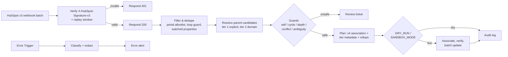

# n8n-hubspot-company-parent-child-hierarchy-linker

**An automated corporate family-tree builder and ARR rollup engine for HubSpot, built on n8n and plain Node.js.**

When a company is created or one of its identity fields changes, this workflow works out which parent account it belongs to. It checks the link against self-parenting, circular chains and a depth limit, then attaches the child through the HubSpot CRM v4 Associations API. Finally it rolls annual revenue and deal value up to every ancestor, all the way to the ultimate parent. Anything ambiguous or unsafe goes to a human review queue instead of being written.

By default it runs with `DRY_RUN=true` and `SANDBOX_MODE=true`, and the workflow ships with `active: false`.

---

## Contents

- [Why I built this](#why-i-built-this)
- [How it works](#how-it-works)
- [Parent resolution tiers](#parent-resolution-tiers)
- [Cycle and depth protection](#cycle-and-depth-protection)
- [ARR and deal rollup engine](#arr-and-deal-rollup-engine)
- [Safety controls](#safety-controls)
- [Repository layout](#repository-layout)
- [Setup](#setup)
- [Configuration reference](#configuration-reference)
- [Decision reference](#decision-reference)
- [Development and testing](#development-and-testing)
- [Known limitations](#known-limitations)
- [About the author](#about-the-author)
- [Disclaimer & License](#disclaimer--license)

---

## Why I built this

HubSpot supports parent and child companies natively, but it does not build the tree for you. In most portals I audit, the signals are already there: a `parent_company_domain` from an import, a DUNS parent from an enrichment vendor, a regional subdomain like `emea.example.com`. What's missing is a reliable process that turns those signals into associations without creating loops, wrong parents or double-counted revenue.

I designed this repository around three rules:

1. **Deterministic over clever.** The match comes from a fixed priority order, never from a confidence score.
2. **Refuse rather than guess.** Cycles, conflicts and ambiguous matches go to a person.
3. **The tested code is the deployed code.** `workflow.json` is generated from `src/`, and CI fails if the two drift apart.

## How it works



| n8n node | Source module | Responsibility |
| --- | --- | --- |
| HubSpot Company Webhook | n/a | Receives the batch with `rawBody: true`, responds through Respond to Webhook nodes |
| Verify HubSpot Signature | `src/hubspot-signature.js` | HMAC-SHA256 v3 check, `SIGNATURE_MAX_AGE_MS` replay window, future-timestamp rejection, constant-time compare |
| Filter & Deduplicate Events | `src/event-filter.js` | `company.creation` / `company.propertyChange` only, watched properties, `EXPECTED_PORTAL_ID` allowlist (fails closed), `HUBSPOT_APP_ID` loop prevention, one work item per company |
| Resolve, Guard & Link Hierarchy | `src/hierarchy-linker.js` | Candidate resolution, cycle and depth guards, rollups, dry-run and sandbox gating, writes and post-write verification |
| Needs Human Review? / Create Review Ticket | n/a | POSTs review tickets to `REVIEW_QUEUE_WEBHOOK_URL` |
| Audit Log Enabled? / Send Audit Log | n/a | POSTs a structured audit payload for every decision to `AUDIT_LOG_WEBHOOK_URL` |
| Error Trigger / Classify Error / Send Error Alert | `src/hierarchy-linker.js` | Classifies failures (rate limit, auth, server, network…), redacts tokens and sends an alert |

## Parent resolution tiers

Tiers are evaluated in order, and the first tier that produces a candidate wins.

**Tier 1: explicit metadata.** These properties are read from the child:

| Property | Source label | Matched against |
| --- | --- | --- |
| `parent_company_domain` | `explicit_parent_domain` | `domain` |
| `parent_domain` | `explicit_parent_domain` | `domain` |
| `clearbit_parent_domain` | `clearbit` | `domain` |
| `apollo_parent_domain` | `apollo` | `domain` |
| `duns_parent_id` | `duns` | `duns_number` (8 digits padded to 9) |
| `ultimate_parent_domain` | `ultimate_parent_domain` | `domain`, used only when no immediate-parent source matched |

If several sources point to the same company, their labels merge into one candidate. If they point to different companies, the result is `review` with `AMBIGUOUS_PARENT`. If explicit metadata exists but names a company that isn't in the CRM, I stop with `EXPLICIT_PARENT_NOT_FOUND`. I don't fall back to a domain heuristic that could contradict the explicit signal.

**Tier 2: domain structure.** This tier only runs when no explicit metadata is present.

1. **Subdomain → root domain.** `emea.example.com` matches the company whose domain is `example.com`. Multi-part suffixes such as `co.uk` and `com.au` are handled.
2. **Regional entity → brand domain.** `example.co.uk` matches `example.com`, or each TLD in `REGIONAL_PARENT_TLDS`.

**Exclusion lists.** Free-mail domains (gmail.com, outlook.com and others) and parked or shared-hosting platforms (myshopify.com, wixsite.com, github.io, vercel.app and others) are never used as a signal. `tenant.myshopify.com` will never be rolled up under `myshopify.com`. You can extend both lists with `EXTRA_FREE_MAIL_DOMAINS` and `EXTRA_PARKED_DOMAINS`.

## Cycle and depth protection

Before any link, I walk upward from the proposed parent along `hs_parent_company_id`, for at most `MAX_HIERARCHY_DEPTH` hops (default 5):

| Situation | Example | Result |
| --- | --- | --- |
| Self-parenting | `A -> A` | `review` / `SELF_PARENT` |
| Direct 2-node cycle | `A -> B -> A` | `review` / `CIRCULAR_REFERENCE`, `cyclePath: [A, B, A]` |
| Multi-hop cycle | `A -> B -> C -> A` | `review` / `CIRCULAR_REFERENCE`, `cyclePath: [A, B, C, A]` |
| Cycle already in the data above the parent | `P -> X -> Y -> X` | `review` / `EXISTING_CYCLE` |
| Child depth + height of child's own subtree > limit | 6 levels below the root with the default limit | `review` / `DEPTH_EXCEEDED` |
| Child already has a different parent | | `review` / `PARENT_CONFLICT` (never overwritten) |

Depth counts edges below the ultimate parent. `hierarchy_tier` is written as `depth + 1`, so the ultimate parent is tier 1.

## ARR and deal rollup engine

After a link, or after a revenue change inside an existing family, I collect the family breadth-first from the ultimate parent. The new link is projected in before computing, so dry-run output shows the totals you would get. The rollup:

- Builds a spanning tree with a global visited set, so **every company is counted exactly once**. That holds for duplicate association rows, diamond shapes where one child is reachable through two parents, and cycles in source data. Ignored duplicates are reported in `rollupSummary.duplicatesIgnored`.
- Aggregates bottom-up in integer cents to avoid floating-point drift. Values that are missing, non-numeric or negative count as zero.
- Writes the following to every company on the path from the ultimate parent down to the changed company, and to the company itself when it has subsidiaries:
  - `rolled_up_family_arr`: own `annualrevenue` plus that of every descendant
  - `rolled_up_child_count`: number of unique descendants at all levels
  - `rolled_up_total_deal_value`: open `hs_total_deal_value` plus closed-won `total_revenue` across the family
- Writes `hierarchy_tier`, `ultimate_parent_company_id` and `hierarchy_last_synced_at` to the path and to the entire subtree being attached, so a re-parented branch is re-tiered in one pass.
- Skips the rollup and records `FAMILY_TRUNCATED` when a family is larger than `MAX_FAMILY_SIZE`.

## Safety controls

| Control | Default | Behaviour |
| --- | --- | --- |
| `DRY_RUN` | `true` | Every decision, planned association and property update is computed and audited, and nothing is written |
| `SANDBOX_MODE` | `true` | With `DRY_RUN=false`, live writes happen only when the event's portal equals `HUBSPOT_SANDBOX_PORTAL_ID`. Any other portal is forced to dry-run (`PORTAL_IS_NOT_SANDBOX`) |
| Production | n/a | Requires **both** `DRY_RUN=false` and `SANDBOX_MODE=false` |
| Portal allowlist | fail closed | If `EXPECTED_PORTAL_ID` is unset, every event is rejected |
| Loop prevention | on | Changes whose `changeSource` is INTEGRATION/API and whose `sourceId` matches `HUBSPOT_APP_ID` are dropped, as are changes to the properties this workflow writes |
| Post-write verification | on | After the PUT, the child's associations are read back. If the link is missing, the result becomes `review` / `VERIFICATION_FAILED` and no properties are written |
| Rate limits | on | 429 and 5xx responses are retried up to `HUBSPOT_MAX_RETRIES` times, honouring `Retry-After` |
| Batch isolation | on | A failure on one company becomes an `error` result. Auth and config failures re-throw so the Error Trigger fires |
| Redaction | on | Bearer tokens, private app tokens and key query parameters are stripped from error messages |

## Repository layout

```
.
├── src/
│   ├── hubspot-signature.js     # X-HubSpot-Signature-v3 + replay window
│   ├── event-filter.js          # batch filtering, allowlist, loop guard, dedupe
│   └── hierarchy-linker.js      # resolution, guards, rollups, HubSpot client, audit
├── scripts/
│   ├── build-workflow.js        # renders workflow.json from src/ (supports --check)
│   └── send-test-webhook.js     # signs and sends a synthetic batch
├── test/
│   ├── fixtures/hubspot-company-webhook-batch.json
│   ├── hierarchy-linker.test.js # unit + orchestration tests
│   └── workflow.test.js         # sync, structure, Code node execution, secret/PII scans
├── workflow.json                # generated - do not edit by hand
├── .env.example
├── DISCLAIMER.md
├── LICENSE
└── README.md
```

## Setup

### 1. HubSpot

1. **Create custom company properties** (Settings → Properties → Company):

   | Internal name | Type |
   | --- | --- |
   | `parent_company_domain`, `parent_domain`, `ultimate_parent_domain` | Single-line text |
   | `clearbit_parent_domain`, `apollo_parent_domain` | Single-line text (only if you map enrichment into them) |
   | `duns_number`, `duns_parent_id` | Single-line text |
   | `hierarchy_tier`, `rolled_up_child_count` | Number |
   | `rolled_up_family_arr`, `rolled_up_total_deal_value` | Number (currency format) |
   | `ultimate_parent_company_id` | Single-line text |
   | `hierarchy_last_synced_at` | Date and time |

2. **Create a private app** with the scopes `crm.objects.companies.read` and `crm.objects.companies.write`. Store its token as `HUBSPOT_PRIVATE_APP_TOKEN`.
3. **Subscribe to webhooks** on the app that will call n8n: `company.creation`, plus `company.propertyChange` for each watched property. Point the target URL at `https://your-n8n-webhook-domain.com/webhook/hubspot-company-hierarchy`. Store the app's client secret as `HUBSPOT_APP_CLIENT_SECRET` and its app ID as `HUBSPOT_APP_ID`.
4. Do this in a **developer test account or sandbox portal** first.

### 2. n8n

1. Set the variables from `.env.example` in your n8n environment. `N8N_BLOCK_ENV_ACCESS_IN_NODE=false` and `NODE_FUNCTION_ALLOW_BUILTIN=crypto` are required.
2. Import `workflow.json` (Workflows → Import from File).
3. Create an **HTTP Header Auth** credential for your audit and review endpoints. Select it on the three HTTP Request nodes, which reference `REPLACE_WITH_N8N_CREDENTIAL_ID` until you do.
4. In workflow settings, set **Error Workflow** to this workflow. It replaces `REPLACE_WITH_THIS_WORKFLOW_ID`.
5. Send a test batch (see below), review the audit output, and only then activate the workflow.

### 3. Going live

1. Run in the sandbox with `DRY_RUN=true` and review the audit payloads.
2. Set `DRY_RUN=false` with `SANDBOX_MODE=true` and `HUBSPOT_SANDBOX_PORTAL_ID` set. Verify the associations and rollups in the sandbox.
3. Back up production company data.
4. In production, start with `DRY_RUN=true`. Only set `DRY_RUN=false` and `SANDBOX_MODE=false` once the audit log matches your expectations.

## Configuration reference

All variables are documented with safe defaults in [`.env.example`](.env.example).

| Variable | Default | Purpose |
| --- | --- | --- |
| `HUBSPOT_PRIVATE_APP_TOKEN` | placeholder | CRM API token |
| `HUBSPOT_APP_CLIENT_SECRET` | placeholder | Webhook signature secret |
| `HUBSPOT_APP_ID` | placeholder | Loop prevention |
| `EXPECTED_PORTAL_ID` | placeholder | Portal allowlist (fail closed) |
| `HUBSPOT_SANDBOX_PORTAL_ID` | placeholder | Portal where live writes are allowed while `SANDBOX_MODE=true` |
| `WEBHOOK_PUBLIC_URL` | placeholder URL | Exact URL HubSpot signs |
| `SIGNATURE_MAX_AGE_MS` | `300000` | Replay window |
| `WATCHED_PROPERTIES` | 6 properties | Trigger properties |
| `MAX_EVENTS_PER_BATCH` | `100` | Batch cap |
| `DRY_RUN` | `true` | No writes |
| `SANDBOX_MODE` | `true` | Live writes only in the sandbox portal |
| `MAX_HIERARCHY_DEPTH` | `5` | Levels below the ultimate parent |
| `MAX_FAMILY_SIZE` | `500` | Rollup size cap |
| `HUBSPOT_MAX_RETRIES` | `3` | 429/5xx retries |
| `HUBSPOT_ASSOC_TYPE_PRIMARY_PARENT` | `14` | Child → parent association type |
| `HUBSPOT_ASSOC_TYPE_CHILD` | `13` | Parent → child association type |
| `ENABLE_SUBDOMAIN_MATCHING` | `true` | Tier 2 subdomain rule |
| `ENABLE_REGIONAL_MATCHING` | `true` | Tier 2 regional rule |
| `REGIONAL_PARENT_TLDS` | `com` | Brand TLDs for regional matching |
| `ROLLUP_ENABLED` | `true` | Write rolled-up totals |
| `EXTRA_FREE_MAIL_DOMAINS` / `EXTRA_PARKED_DOMAINS` | empty | Additions to the exclusion lists |
| `AUDIT_LOG_WEBHOOK_URL` | empty | Audit sink (disabled when empty) |
| `REVIEW_QUEUE_WEBHOOK_URL` | empty | Review queue (disabled when empty) |
| `ERROR_ALERT_WEBHOOK_URL` | empty | Error sink (falls back to the audit URL) |

## Decision reference

| Action | Reasons | Writes |
| --- | --- | --- |
| `link` | `NEW_LINK` | Association + metadata + rollups (live only) |
| `rollup` | `ALREADY_LINKED`, `IN_HIERARCHY` | Metadata + rollups (live only) |
| `review` | `SELF_PARENT`, `CIRCULAR_REFERENCE`, `EXISTING_CYCLE`, `DEPTH_EXCEEDED`, `AMBIGUOUS_PARENT`, `PARENT_CONFLICT`, `VERIFICATION_FAILED` | None (after a failed verification, the association may exist but no properties are written) |
| `skip` | `NO_PARENT_SIGNAL`, `EXPLICIT_PARENT_NOT_FOUND`, `EXCLUDED_DOMAIN`, `COMPANY_NOT_FOUND` | None |
| `error` | `RATE_LIMIT`, `SERVER`, `NETWORK`, `NOT_FOUND`, `CONFLICT`, `VALIDATION`, `UNKNOWN` | None |

Every result produces an audit payload of type `hubspot.company_hierarchy.audit`. Every `review` result also produces a ticket of type `hubspot.company_hierarchy.review`, which includes the candidates, the cycle path and a suggested resolution.

## Development and testing

```bash
npm install
npm test                          # Jest: unit, orchestration, workflow and security suites
npm run build:workflow            # regenerate workflow.json after editing src/
npm run build:workflow:check      # fails if workflow.json is out of sync (use in CI)
npm run send:test-webhook -- --print   # show a signed synthetic request without sending it
npm run send:test-webhook              # sign and POST the fixture batch to N8N_WEBHOOK_URL
```

The test suites cover:

- **Matching:** domain, subdomain and regional matching, DUNS, Clearbit and Apollo metadata, the ultimate-parent fallback, and the free-mail and shared-hosting exclusions.
- **Guards:** self-parenting, 2-node and multi-hop cycles, pre-existing cycles, depth limits including subtree height, parent conflicts and ambiguity.
- **Rollups:** rollup math, including diamonds, duplicate association rows, cycles and float precision.
- **Modes and errors:** dry-run, sandbox and production gating, post-write verification failure, batch error isolation and error classification.
- **Webhooks and transport:** signature verification (tampering, wrong secret, replay, future skew, URI decoding) and the HubSpot transport (retries, pagination, type IDs 13 and 14).
- **Workflow:** that `workflow.json` matches a fresh build byte for byte, that every `src/` module is embedded verbatim, that node IDs and names are unique and every connection is valid, and that each Code node compiles and runs against mocks.
- **Security:** scans for HubSpot tokens, Bearer literals, private keys, cloud and chat tokens, non-RFC 2606 email addresses, unexpected hosts in `workflow.json`, and placeholder-only credentials in `.env.example`.

All fixtures use synthetic IDs (`1001`, `1234567`) and RFC 2606 domains (`example.com`, `example.org`, `example.net`).

## Known limitations

- A child is only re-evaluated when one of its own watched properties changes. If the parent record is created after the child, update a watched property on the child, or run a backfill, to link it.
- Tier 2 regional matching only checks the TLDs listed in `REGIONAL_PARENT_TLDS`. It doesn't search fuzzily by brand name.
- `hs_parent_company_id` is read for upward traversal. If your portal's association data and that property disagree, the post-write verification will surface it as `VERIFICATION_FAILED`.
- Code nodes rely on `this.helpers.httpRequest` and `$env`. Check that your n8n version and security settings allow both.

## About the author

I'm **DH Robin** (`dhRobin Systems`), a Revenue Infrastructure Architect working across HubSpot CRM architecture, RevOps automation and outbound systems. I build the plumbing that keeps CRM data trustworthy enough to run a revenue team on.

- Website: [dhrobinsystems.com](https://dhrobinsystems.com)
- Portfolio: [behance.net/dhrobinsystems](https://behance.net/dhrobinsystems)
- LinkedIn: [linkedin.com/in/dhrobin](https://linkedin.com/in/dhrobin)
- Contact: robin@dhrobinsystems.com

*Revenue Infrastructure Architect | HubSpot CRM Architecture | RevOps Automation | Outbound Systems*

## Disclaimer & License

### ⚠️ Disclaimer & Liability Limitation

**Use at your own risk.** The code, workflows, and scripts provided in this repository (`n8n-hubspot-company-parent-child-hierarchy-linker`) are for educational and architectural demonstration purposes.

* **No Liability:** The author and dhRobin Systems assume no responsibility or liability for any direct, indirect, incidental, or consequential damages resulting from the use, misuse, or deployment of these scripts. This includes CRM data corruption, broken company associations, inaccurate ARR or revenue rollups, infinite webhook loops, API rate-limit exhaustion, and third-party enrichment billing overages.
* **No Warranty:** All software, n8n JSON blueprints, and JavaScript modules are provided "AS IS" without warranty of any kind, express or implied, including but not limited to merchantability, fitness for a particular purpose, or non-infringement.
* **Production Testing Required:** Always test thoroughly in an isolated staging environment (for example a HubSpot developer test account or sandbox) with `SANDBOX_MODE=true` and `DRY_RUN=true` enabled before connecting live HubSpot credentials. Treat every association change and rolled-up property overwrite as irreversible at scale.
* **Third-Party APIs & Compliance:** Users are solely responsible for complying with the terms of service, rate limits, data privacy regulations (GDPR/CCPA), and security policies of HubSpot and any connected services. That includes confirming a lawful basis for storing third-party parent-company metadata, respecting enrichment providers' usage terms and credit limits, and reviewing every automated association and rollup before relying on it for reporting.

The full disclaimer is also available in [DISCLAIMER.md](https://github.com/dhrobinsystems/n8n-hubspot-company-parent-child-hierarchy-linker/blob/main/DISCLAIMER.md).

### License

Released under the MIT License. Copyright (c) 2026 dhRobin Systems. See [LICENSE](https://github.com/dhrobinsystems/n8n-hubspot-company-parent-child-hierarchy-linker/blob/main/LICENSE).

---

MIT © 2026 dhRobin Systems — Provided as-is, see the disclaimer.
